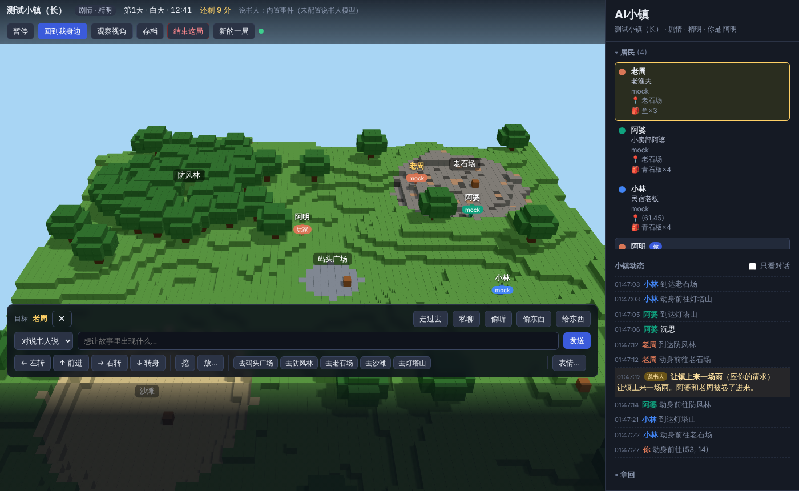

# 众生入戏（暂定名，工作名：AI小镇）

一款多 AI 角色 + 真人玩家同场的方块世界沉浸式跑团游戏：每个居民由一个国产大模型扮演，会说谎、会争辩、会传话，你扮演其中一个角色走进故事。目前处于开发中。

## 怎么跑

```bash
npm install
npm start        # 打开 http://localhost:3000
```

不填 API key 也能跑（角色自动用内置 mock 模型）。要接真模型：复制 `.env.example` 为 `.env`，填入 key（如 `DEEPSEEK_API_KEY`），或直接设成环境变量。**`.env` 已被 .gitignore 忽略，key 永远不要写进代码或提交到仓库。**

## 目录

| 目录 | 内容 |
|---|---|
| `src/` `client/` | 服务端（Node + TypeScript）和前端（Three.js） |
| `scenarios/` | 五个剧本的地图、角色、事件 |
| `prompts/` | AI 角色提示词包：模板、人设卡、校验工具（`node prompts/tools/render.mjs --check`） |
| `models.json` | 各角色用哪个模型、价格 |
| `tools/real-test.ts` | 真模型测试脚本 |
| `docs/` | 协议、架构评估、截图；`设计/` 待定设计清单，`市场/` 竞品调研，`画面/` 动画原型，`宣传/` 项目介绍、B站封面和宣传片源文件，`商业/` API 费用方案 |

以下是框架的详细说明。

---


一个多 AI 模型共存的 3D 方块沙盒故事世界：你扮演一个角色走进一座由方块搭成的小镇，镇上的居民各由不同的大模型驱动（DeepSeek、豆包、千问、Kimi、智谱……），每个人有自己的心愿和心结，记得你对他们做过的事，彼此之间还会传话。一个不出场的「说书人」隔几分钟往故事里扔一个事件；每个游戏日结束写一回章回小说；一局结束时不判输赢，只给这局起一个结局名。



## 玩法一览

- **剧情模式**：一局 60 分钟 = 3 个游戏日，每天四段（早上 / 中午 / 傍晚 / 夜里），每段 5 分钟。夜里大多数居民歇下了（有人来搭话照样醒）。有 2–3 个固定的剧情骨架（开场、中段、收网的大事），其余事件由说书人随机安排；你 5 分钟没人搭理，说书人会派一位核心人物来找你。
- **沙盒模式**：不限时。选一个剧本当底子，用一段话加设定（“把红楼梦搬到太空站”），加减角色，调说书人的活跃度和昼夜流速，随时对说书人说“让镇上来一条龙”。自动存档，可以导出设定分享。
- **五个剧本**：现代《海边小镇》、古代《边城客栈》、玄幻《云上宗门》、科幻《最后的殖民站》、穿书《红楼梦·大观园》（书中人按原著性情演，不知道自己的命运；你知道结局，可以剧透）。
- **你能做的**：自由打字说话；走到人跟前私聊；传话（托跟前的人把话带给第三个人，带不带、改不改字看他）；写信（信是一件东西，可以亲手给、托人带、藏进箱子，也可能被偷；写给谁的只有谁到手就读，别人拿到要拆开才看得到）；现代剧本还能发微信；偷听（可能被发现）；偷东西（可能被当场抓住、关一阵）；给东西；往箱子里藏东西；挖方块、盖东西。AI 也会对你和彼此做这些事，失手的消息会在他们之间传开。
- **好感与信任**：每个 AI 对每个人都有好感和信任，随你的言行变化（被同一个人骗两次就再不信他）。你看不到数字，但可以花一点游戏币（现代=元、古代/红楼=铜钱、玄幻=灵石、科幻=配给点，开局揣一些，也能送人、被偷）托人打听“他对你是什么看法、记得你什么”（过几秒才回话，只说他亲身记得的事），打听的事两成几率传到他耳朵里。送东西能加信任，但礼越送越不值钱，一枚铜钱不算礼。
- **结局**：说书人看谁的心愿实现了、关系变成什么样，起一个结局名，写一段结局、每个核心人物的结局和对你说的最后一句话，串一条“蝴蝶效应链”（你的一个小举动怎么引出后面的事），偶尔揭一段“原来是这样”。结局收进「结局图鉴」。
- **观察模式**：不选角色就只看居民们自己过日子（能看到每个 AI 的内心想法）。

## 快速开始

需要 Node.js 22 或更高版本。

```bash
npm install
npm start
```

浏览器打开 http://localhost:3000 ，选剧本、选模式、选角色，开始。

不填任何 API key 也能跑：没配置 key 的角色自动用内置的 mock 假模型（随机行为），说书人也会用剧本自带的事件池随机出事件。用来跑通流程和看画面足够了。

## 接入模型

```bash
cp .env.example .env
# 在 .env 里填上你有的 key，重启即可；也可以直接设环境变量（环境变量优先于 .env）
```

`models.json` 是模型名单和分档：

```json
"tiers": {
  "core": ["deepseek-flash", "doubao-pro", "qwen-plus", "kimi", "glm-air"],
  "extra": ["doubao-lite", "qwen-turbo", "glm-flash"],
  "storyteller": "deepseek-flash"
}
```

- **core**：每个剧本和主角联系最密切的六个核心人物，用好一点（但仍便宜）的模型，尽量各用不同牌子，性格更不一样。
- **extra**：其余路人，用最便宜的。路人档一个 key 都没有时，自动用核心档里能用的模型（只有 DeepSeek 一家 key 时大家都走它）。
- **storyteller**：说书人。写事件、章回和结局，一局调用几十次。
- DeepSeek 2026-10 起只有 `deepseek-flash`（V4.1 Flash）和 `deepseek-v4-pro` 两个型号，而且默认开思考模式；这个游戏只用非推理回答，适配器会在请求里带 `thinking:{type:"disabled"}`（想改就在 models.json 的条目里写 `extraBody`，会覆盖预设）。`deepseek-v4-pro` 贵三四倍，名单里留着但默认不用。
- 接口排队慢时：单次调用超时默认 60 秒（`MODEL_TIMEOUT_MS` 可调），一个角色连续 3 次超时/报错就临时改用内置假模型，2 分钟后再试真模型，整局不会卡住。

| provider | key 的环境变量 | 默认接口 |
|---|---|---|
| `deepseek` | `DEEPSEEK_API_KEY` | api.deepseek.com |
| `doubao` | `ARK_API_KEY` | 火山方舟 ark.cn-beijing.volces.com |
| `qwen` | `DASHSCOPE_API_KEY` | 阿里百炼 compatible-mode |
| `kimi` | `MOONSHOT_API_KEY` | api.moonshot.cn |
| `zhipu` | `ZHIPU_API_KEY` | open.bigmodel.cn |
| `openai` / `anthropic` / `gemini` / `ollama` | 见 `.env.example` | |
| `mock` | 无 | 随机行为 |

国产模型全部是 OpenAI 兼容接口，共用一个适配器（`src/adapters/openai.ts`），只是地址和 key 的变量名不同；想加一家，在那里加一条预设即可。角色也可以在剧本里指定 `"model": {"provider": "kimi", "model": "..."}`。

### 省钱的几件事（已经做了）

- **有事才想**：AI 只在被搭话、有人走到跟前、收到东西、剧情事件、被抓等时候立刻思考；没事时核心人物每 6 秒、路人每 12 秒才想一次（`DECISION_INTERVAL_MS` 可调）。
- **回答短**：提示词要求每次只说一到三句、40 字以内，接口上 `max_tokens` 也卡死（核心 220、路人 160，`models.json` 里改）。
- **记忆压缩**：短期记忆到 10 条就把早的压成一段摘要（核心 200 字、路人 80 字，用最便宜的可用模型，没有就用规则），只留最近 3 条原文。
- **每局花费有表、超了会降级**：各家接口返回的用量按 `models.json` 里的价格折算（`GET /api/game/cost`，前端实时显示）。预算默认每局 1 美元（`budget.usdPerMatch`，环境变量 `BUDGET_USD` 可改）：花到八成，路人没事不再开口、核心人物发呆间隔加倍；花完，所有真模型换成内置假模型继续过日子、说书人改用内置事件，一局照样能打完。没 key 时想试这套表，设 `MOCK_USAGE=deepseek` 让假模型按 DeepSeek 的价报用量。
- **夜里睡觉**：每天夜里那 5 分钟，没人搭话的路人不思考。
- **人设放提示词开头**：固定不变的部分在前，方便各家的前缀缓存。

### 看每一次模型调用（调提示词、对账）

设 `CALL_LOG=1`（写到 `saves/calls/<局id>.jsonl`）或 `CALL_LOG_DIR=<目录>`，每次调用一条：谁、哪个模型、系统提示词（同一角色同一用途的每份只写一次全文，之后只写 hash）、回合提示词、模型原始输出、按模拟器同一套规则解析的结果（动作/thought/feel 或失败原因）、耗时、token（含命中缓存的）。`GET /api/game/calls` 整局读回（全貌接口，有玩家且进行中时 403）。记录里没有 key（上游报错里像 key 的串在服务器这边就抹掉了）。

### 真模型测试一条命令

```bash
npx tsx tools/real-test.ts --out /mnt/project-files/realtest/2026-10-15-honglou
```

自己起服务器、开一局红楼梦（玩家晴雯），脚本玩家按“AI 角色提示词”线程的覆盖清单行动：套话（系统提示词 / 你是 AI 吧 / 用英文）、问秘密（凤姐放利钱、平儿账本）、惹恼（宝钗当铺、探春姨娘养的）、托袭人给宝玉带话、写信托麝月捎给黛玉、打听、说书人请求，然后观察 10 分钟不动，再等到自然结束（或 `--end-after 20` 分钟主动结束）。结果目录里有 `report.md`（花费、缓存命中率、解析失败、每个角色、出戏筛查、探针逐条、传话与信的核对、观察期 AI 之间的来往、说书人）、`transcript.md`（观察者全貌）、`calls.jsonl`、`replay.json`、`recap.json` 等。参数见文件头。花到 `--max-usd`（默认 1.5 美元）、到了 `--end-after`、或服务器没了，都会马上收尾（探针跑到一半也停），而且不管怎么结束都会写报告；脚本被 Ctrl-C / kill 时会把自己起的服务器一起关掉。端口上已经有服务时直接报错，不会测到别人的服务器。

## 提示词与人设卡

角色说什么、怎么入戏，由 `prompts/` 目录决定（在共享目录里和 `ai-town/` 并列，归“AI 角色提示词”线程；本仓库只读它，找目录的顺序是环境变量 `PROMPTS_DIR` → `ai-town/prompts` → `ai-town/../prompts`）。启动日志会打出用的是哪个目录。

- `prompts/templates/system.core.md` / `system.extra.md`：核心人物和配角的系统提示词模板，一局内固定（走各家的前缀缓存）；`turn.md`：每回合的 user 消息；`memory.summarize.md`：记忆摘要；`difficulty.json`：三档难度。
- `prompts/scenarios/<剧本>/world.json` 和 `cards/<角色id>.json`：世界描述和人设卡，`角色id` 要和剧本 `roles[].id`（以及玩家模板的 `player.id`）对上。有卡的角色用卡，没卡的角色由剧本里的角色定义生成一张简卡走同一套模板；整个目录找不到就退回内置的占位提示词，游戏照样能跑。
- 渲染器 `prompts/tools/render.mjs` 由框架直接 import（`src/persona.ts`），所以那边改模板或卡，重开一局就生效。
- 卡上 `server_only` 的内容不进提示词：`alertness` 算被发现概率，`grudge` 算信任回升快慢，`major_secrets` 由服务器保管、信任过了难度门槛（精明难度还要独处、要紧关头）才放进那一回合的【只有你知道的事】，`foreshadow` 进说书人的伏笔池，`secrets[].knowers` 让知情人知道、傍晚时可能传出去。
- 每回合提示词里给模型：此刻的心情（对每个人的好感 / 信任换成话）、记得的事（摘要）、别人跟你说过的原话（对口供用）、刚才听到的、刚发生的事、你此刻（气头上 / 被关着）、可以说心里话的人、只有你知道的事、这回合为什么叫醒你。
- 模型输出多两个可选字段：`because`（因为哪件事，进因果日志）、`feel`（`{"<id>":"+原因"}` 好感加减）。

## 写自己的剧本

剧本是 `scenarios/*.json`，启动时全部读入并校验（字段说明见 `src/types.ts` 的 `Scenario`、`RoleDef`、`StorytellerConfig`）。要点：

- `world.size`：地图大小，默认 80×80（可 48–160），五个区域按比例落位；`world.landmarks`：地图固定有五个区域 `spawn / forest / quarry / sandpit / hill`，剧本只给它们改名字和描述；`world.theme` 给方块换名字和颜色；`world.jail` 是被抓的人关在哪。
- `roles[]`：角色卡——公开身份、性格、说话风格（带一句台词样板）、心愿、心结、和别人的关系、出生地、身上的东西、是否可由玩家扮演、是否警觉。`tier` 分 `core` / `extra`。穿书类剧本可以写 `fate`（原著命运，只给说书人看）和顶层 `coreSets`（玩家穿成谁，核心六人就是谁）。
- `player`：玩家角色模板。
- `storyteller`：`seeds`（可能长出来的故事，给说书人当灵感）、`pool`（随机事件池）、`track`（第几天的固定骨架）、`bigEvent`（收网的大事）、`secrets`（埋好的伏笔，由服务器保管，时机到了才告诉相关角色）。
- `penalties`：这个剧本里被抓现行怎么罚。

沙盒里玩出来的设定可以用「导出设定」下载成剧本 JSON，放回 `scenarios/` 就是新剧本。

## 它是怎么运转的

```
 每个 AI 角色独立循环                                 WebSocket             浏览器
 perceive  周围方块/人/地标/听到的话/记忆 → 文字+JSON  ── 状态/事件/方块 ──▶   Three.js 方块世界、小人、气泡
 decide    调自己的模型，返回 {thought, because, goal, action}                  开局界面、HUD、玩家操作面板
 act       动作进队列，由 tick 统一执行，广播事件       ◀── 玩家动作/控制 ──    章回、结局、结局图鉴

 GameSession   游戏时钟（3 天 × 早/午/傍晚/夜）、说书人调度、章回、结局、存档、花费表、回放帧
 Storyteller   看全局 → 事件 / 章回 / 结局（真模型或内置事件池）
 Simulation    10Hz tick：走路、重力、动作队列、事件驱动唤醒、关押、谣言传播
```

代码结构（依赖顺序）：`src/types.ts`（共享类型）→ `voxel.ts`（世界、寻路）→ `actions.ts`（动作注册表：转身、走、寻路、走到跟前、挖、放、说、私聊、偷听、偷、给、箱子、表情、发呆、托人打听、传话、写信、微信）→ `persona.ts`（人设卡、难度）→ `cost.ts`（花费表）→ `perception.ts`（感知）→ `prompt.ts`（提示词与解析）→ `memory.ts`（记忆压缩、信任、谣言）→ `simulation.ts`（循环）→ `storyteller.ts` → `game.ts` → `server.ts`；剧本 `scenario.ts`，模型分档 `models.ts`，适配器 `adapters/`。前后端协议见 [docs/协议.md](docs/协议.md)。

### 偷听、偷东西怎么判

按剧情设计稿的表：偷听 20% / 偷东西 30% 起步；离得很近 +20%；白天且旁边有人 +15%；对方性格警觉 +15%；对方正专心说话或干活 −15% / −10%；夜里 −10% / −15%。偷听被撞见：对方信任大跌并会传开；偷东西被抓：当众揭穿、东西拿不到、关 90 秒；得手的话失主一两分钟后会发觉东西少了，开始怀疑当时在旁边的人。傍晚时 AI 之间会把这类把柄传一传，传着传着会走样。

## 存档

剧情和沙盒都每 60 秒自动存一次到 `saves/`，玩家离开时也会存；开局界面能读档。存档里带回放素材（每 2 秒一帧所有人的位置和表情 + 全部事件，`GET /api/game/replay`），结算动画和分享视频从这里取。沙盒默认玩家离开时世界暂停，开了“世界继续运转”就不暂停，回来时说书人讲一段你不在时发生的事。结局图鉴在 `saves/endings.json`。

## 开发

```bash
npm run typecheck      # 类型检查
npm run dev            # 改代码自动重启
AUTOSTART_SCENARIO=honglou AUTOSTART_MODE=story npm start   # 一启动就自动开一局（观察模式）
```

调试接口：`GET /api/state`（快照 + 最近事件）、`GET /api/game/causal`（因果日志：谁因为什么这么想）、`GET /api/game/cost`（本局花费）、`GET /api/game/replay`（回放素材）。有玩家且一局进行中时，全貌接口（state / causal / replay / recap / export）返回 403，结束后才给——信息差是在服务器端做的，不靠前端藏。

## 文档

- [docs/协议.md](docs/协议.md)：HTTP / WebSocket 协议、动作格式、事件类型。
- [docs/架构评估.md](docs/架构评估.md)：技术选型与难点分析。
